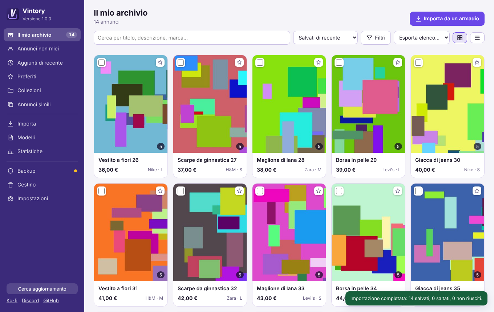

# Vintory

<p align="center"></p>

**Archivio personale dei tuoi annunci Vinted.** Vintory è un'estensione per Chrome, Edge e Brave che conserva una copia completa di ogni annuncio (testi, prezzo, marca, taglia, condizioni e tutte le foto) dentro il browser. La copia resta consultabile anche quando l'annuncio viene eliminato da Vinted.

**Versione 1.1.0** · solo lettura: Vintory non pubblica, non modifica e non elimina nulla su Vinted.



*Schermata con dati di prova: le foto sono riquadri colorati generati per i test.*

## Installazione

1. Scarica **`Vintory-1.1.0.zip`** da questa pagina ed estrailo: ottieni la cartella `Vintory`.
2. Apri `brave://extensions` (oppure `chrome://extensions` o `edge://extensions`) e attiva la **Modalità sviluppatore**.
3. Premi **Carica estensione non pacchettizzata** e scegli la cartella `Vintory`.

Per aggiornare: **Cerca aggiornamento** (nel popup o nella dashboard) scarica il nuovo zip; estrailo sopra la stessa cartella. Vintory se ne accorge da solo e mostra **Installa l'aggiornamento** nel popup e nella barra laterale (c'è anche in Impostazioni › Aggiornamenti). L'archivio non viene toccato.

> **Il backup conta.** L'archivio vive dentro il browser: se rimuovi l'estensione viene cancellato. Fai un backup da **Backup › Crea backup (ZIP)** e tienilo fuori dal browser. Vintory te lo ricorda.

## Come si usa

- **Salvare un annuncio:** apri la sua pagina su Vinted e premi **Salva in Vintory** (in basso a sinistra), oppure usa l'icona dell'estensione. Il badge dell'icona dice se l'annuncio è da salvare (`+`), salvato (`✓`) o cambiato su Vinted dopo il salvataggio (`!`).
- **Salvarne tanti:** apri il tuo armadio e premi **Importa il mio armadio**. Vedi l'anteprima, scegli gli annunci e parte il salvataggio, uno alla volta. Se chiudi il browser a metà, riprendi da **Importa**.
- **Annunci di altri:** si possono salvare, dopo una conferma, e finiscono nella sezione **Annunci non miei**, fuori da valore e statistiche.
- **Ritrovare:** ricerca, filtri (marca, categoria, taglia, colore, condizioni, prezzo), filtri salvati, preferiti, collezioni.
- **Riusare:** **Prepara** apre una copia modificabile, con i tuoi modelli di descrizione, la copia rapida dei testi e lo ZIP delle foto. **Per Vinted_Relist** (nella scheda o sulla selezione) esporta dati e foto di uno o più annunci tuoi in un file che Vinted_Relist potrà leggere: formato in [docs/RELIST_BRIDGE.md](docs/RELIST_BRIDGE.md).

## Funzionalità

| Area | Cosa c'è |
|---|---|
| Salvataggio | pulsante nella pagina e nel popup, badge, avviso per gli annunci non tuoi, nessun doppione (ID Vinted) |
| Importazione | dall'armadio con anteprima, «solo i nuovi», «solo attivi», ripresa dopo un'interruzione, cronologia con l'esito di ogni annuncio |
| Scheda | tutti i dati, foto alla massima risoluzione con zoom, dati tecnici originali, note private, campi personalizzati |
| Modifiche | modifichi solo la copia; ogni cambiamento conserva la versione precedente (ultime 30) e si torna sempre ai dati originali |
| Confronto | «Aggiorna da Vinted» mostra le differenze campo per campo e applica solo ciò che spunti |
| Controlli | «il link funziona ancora?», integrità delle foto con riscaricamento, annunci simili (stessa foto o stesso titolo) |
| Organizzazione | griglia e lista, ordinamento, selezione multipla, preferiti, collezioni, cestino con ripristino per 30 giorni |
| Backup | ZIP completo, ripristino su una nuova installazione, unione senza doppioni, promemoria, backup automatico, CSV ed Excel |
| Altro | statistiche, tema chiaro e scuro, «Cerca aggiornamento», collegamenti aggiornabili da `links.json` |

## Cosa sapere

- **Provata poco su Vinted reale.** Le prove automatiche usano un Vinted simulato, aggiornato con quanto visto sul sito vero nella 1.0.0. La lettura usa le stesse richieste interne di Vinted_Relist: per i tuoi annunci prima il modulo di vendita (`/item_upload/items/<id>`), poi la scheda (`/items/<id>`), infine la pagina dell'annuncio. Un 403 rinnova il token CSRF e riprova una sola volta.
- **Non è un'API ufficiale.** Se Vinted cambia formato, Vintory lo dice invece di salvare dati incompleti. Davanti a CAPTCHA, errori 403 o 429 si ferma: non li aggira mai.
- **Nomi delle categorie:** Vinted fornisce solo il numero della categoria. Vintory ne legge il nome dalla pagina di un annuncio, una volta per categoria, e lo applica a tutti gli altri. Per gli annunci salvati con la 1.0.0 o la 1.0.1 c'è **«Completa i dati mancanti»** (nell'archivio e in Salute).
- **Limite dei backup:** uno ZIP può contenere fino a 4 GB e 65 535 file. Oltre, esporta per collezioni.
- **Backup in una cartella a scelta:** su Brave richiede di attivare «File System Access API» in `brave://flags`; altrimenti si usa la cartella Download.
- Le condizioni d'uso di Vinted limitano gli strumenti esterni: Vintory è pensato per l'uso personale sui propri annunci, con ritmi lenti e senza automazioni di pubblicazione.

## Riservatezza

Tutto resta sul tuo computer. Nessun account, nessun server, nessuna statistica d'uso. Le uniche richieste verso l'esterno sono: Vinted (in sola lettura, dalla tua scheda), le foto dal CDN di Vinted e GitHub per `version.json` e `links.json`. Dettagli in [SECURITY.md](SECURITY.md).

## Sviluppo

JavaScript puro a moduli ES, nessuna dipendenza a runtime, nessuna build.

```bash
npm ci                 # solo fake-indexeddb, per i test
npm test               # controlli + 47 test unitari
npm run test:e2e       # 24 scenari in Chrome contro il Vinted simulato (Python + Playwright)
npm run package        # dist/Vintory-1.1.0.zip e dist/Vintory_GitHub.zip
```

Documentazione: [architettura](docs/ARCHITECTURE.md) · [ponte con Vinted_Relist](docs/RELIST_BRIDGE.md) · [piano di prova](docs/TEST_PLAN.md) · [rilascio](docs/RELEASE.md) · [novità](CHANGELOG.md).

## Sostieni e partecipa

- Ko-fi: https://ko-fi.com/mashaup
- Discord: https://discord.gg/EPsbQCuAkx

Vintory non è affiliato a Vinted. Licenza MIT.
